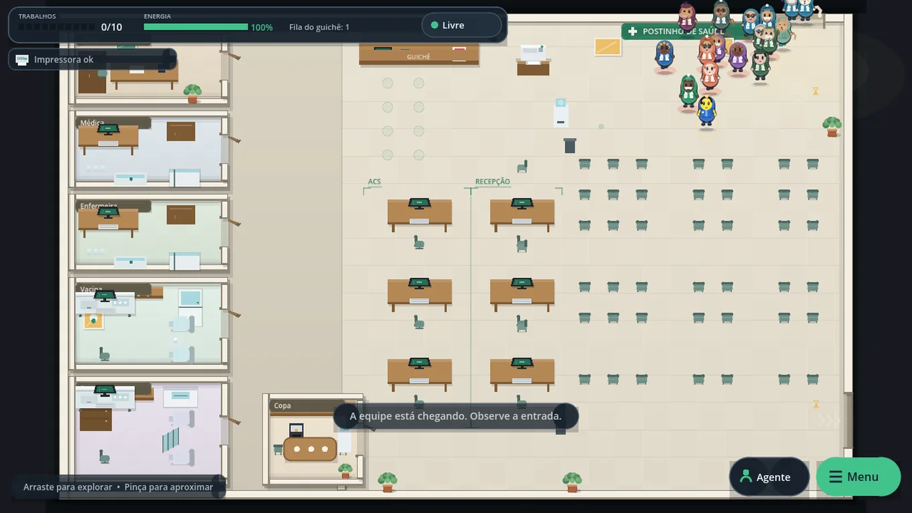

# Postinho de Saúde

**A rotina do Agente Comunitário de Saúde virou jogo.** Um simulador independente, offline e bem-humorado sobre acolher, escutar, organizar filas, usar computadores, consertar a impressora e manter o posto funcionando — sem prova, sem nota e sem dados reais.

[](docs/assets/tela-01-1366.webp)

**Versão atual:** 1.0.1 (Android `versionCode 2`, MSIX `1.0.1.0`) • **Plataformas:** Android 7+ (arm64) e Windows 10/11 (x64) • **Site:** [wavizo-bot.github.io/Postinho-de-Saude](https://wavizo-bot.github.io/Postinho-de-Saude/) • **Download:** [página do app](https://wavizo-bot.github.io/Postinho-de-Saude/app/) • **Release:** [v1.0.1.0](https://github.com/wavizo-bot/Postinho-de-Saude/releases/tag/v1.0.1.0)

> **Aviso:** este é um jogo independente, fictício e humorístico. Não é sistema oficial do SUS, de prefeitura ou de qualquer órgão público; não é prontuário, dispositivo médico, treinamento certificado ou ferramenta de decisão clínica. Nomes, personagens e situações são inventados.

## O que é

O jogador acompanha um dia de trabalho em um postinho fictício. A rotina tem entrada de pacientes, guichê, filas, cadeiras, salas de atendimento, copa, café, impressora que quebra e uma equipe com rotinas próprias. Parte dos funcionários e pacientes é animal antropomórfico, tratada como pessoa normal. Todos os nomes são sorteados de listas fictícias.

O objetivo é entretenimento e conversa sobre o cotidiano do ACS. Não existe resposta certa, pontuação de competência, game over ou avaliação profissional.

## Recursos principais

- Fluxo completo de posto: chegada, guichê, espera, salas, copa e desistência por fila ou tolerância esgotada (60–300 s).
- Salas da chefe, médica, enfermeira, vacina, procedimentos e copa. O jogador pode usar salas vazias, exceto a da chefe.
- 3 computadores internos e 3 de recepção, com distribuição 40/40/10/10 e 10% de chance de problema leve ou grave.
- Impressora que quebra com frequência; consertos e busca de pastas de exame em minijogos.
- Diálogos e demandas com duas respostas sociais, sem resposta certa. O posto continua rodando durante conversas, consertos e exames.
- Energia, tarefas, café, esforço manual e equipe com rotinas e conversas de corredor.
- HUD sem contador de PCs livres e sem relógio de tempo jogado.
- Câmera por arrastar e pinça; menu inferior direito completo; tela inicial com continuar ou nova sessão.
- Save único local, autosave e preferências no aparelho.
- Visual fofo de personagens “feijão/cápsula”, desenhado em código, sem assets externos.

## Privacidade e armazenamento

O jogo **não coleta dados pessoais**, não pede login, não usa anúncios, analytics, rastreadores, câmera, microfone ou localização. O progresso fica em um save local (`sessao_postinho.dat`) e as preferências em `preferencias.json`, na área privada do aplicativo. Não há nuvem, conta ou sincronização entre aparelhos.

Desinstalar o app ou limpar os dados do aplicativo apaga o progresso. Não há dados de pacientes reais: os nomes e situações são fictícios.

Leia a [Política de Privacidade](https://wavizo-bot.github.io/Postinho-de-Saude/politica-de-privacidade.html), os [Termos de Serviço](https://wavizo-bot.github.io/Postinho-de-Saude/termos-de-servico.html) e o [Aviso Legal](https://wavizo-bot.github.io/Postinho-de-Saude/aviso-legal.html).

## Requisitos

| Plataforma | Requisitos |
|---|---|
| Android | Android 7.0 (API 24) ou superior, arm64-v8a. Pacote AAB para loja e APK universal para teste. |
| Windows | Windows 10 1809+ ou Windows 11, x64. MSIX assinado com certificado de teste para sideload. |
| Tela | Paisagem; desenhado para 1280×720 e adaptável a telas maiores. Em celular, gire o aparelho. |
| Internet | Não é necessária para jogar. Só é usada ao abrir links externos. |

## Como executar em desenvolvimento

1. Instale o **Godot 4.7.2** (ou versão compatível 4.x) com o template de exportação Android, se for gerar AAB.
2. Abra a pasta do projeto no editor do Godot e pressione **F5**, ou rode:

```powershell
godot --path . 
```

3. Testes de regras (sem janela):

```powershell
godot --headless --path . --script res://tests/testes.gd
```

4. Teste de interface (precisa de janela, nunca `--headless`):

```powershell
godot --path . --resolution 1280x720 --script res://tests/cliques.gd
```

5. Capturas reais para documentação e loja:

```powershell
godot --path . --resolution 1280x720 --script res://tests/capturar.gd -- build/capturas
python tools/gerar_assets_loja.py
```

## Como gerar os pacotes

Os segredos de assinatura ficam **fora do repositório**, em um cofre local. Os scripts leem o cofre, preenchem o preset temporariamente e restauram o arquivo ao final. Nunca coloque keystore, `.pfx`, senha ou token no Git.

### Windows / MSIX

```powershell
powershell -ExecutionPolicy Bypass -File tools\build_msix.ps1
```

Gera `build/windows/PostinhoDeSaude.exe`, o MSIX `1.0.1.0`, o certificado público `.cer` e o relatório de verificação. Para instalar por sideload, o certificado precisa estar em `LocalMachine\Root` e `LocalMachine\TrustedPeople` (executar como administrador) antes de `Add-AppxPackage`. A Microsoft Store reassina o pacote; o certificado do projeto serve para teste local.

### Android / AAB

```powershell
powershell -ExecutionPolicy Bypass -File tools\build_android_aab.ps1
```

O script prepara o Gradle com **R8 full mode + minify + shrinkResources**, exporta o AAB assinado, confere `r8.json`, `mapping.txt`, DEX, manifesto, `targetSdk 36`, ausência de `AD_ID`, assinatura e gera o APK universal para teste. Requer JDK 17, Android SDK e `bundletool`.

### Versão e assets

```powershell
powershell -ExecutionPolicy Bypass -File tools\stamp_version.ps1
python tools\gerar_icone.py
python tools\gerar_assets_loja.py
```

`version.json` é a fonte carimbada da versão. `project.godot` e `export_presets.cfg` precisam concordar; o script falha se houver divergência. O app exibe a versão dinâmica e, no Android, confirma o `versionName`/`versionCode` pelo `PackageManager`.

## Estrutura de pastas

```
data/            regras, textos, layout, nomes e demandas em JSON
scenes/          cena principal
scripts/         lógica do jogo, manager, visual, versão
sprites/         desenhos procedurais e assets internos
tiles/           tiles do cenário
ui/              HUD, menu, telas e interação
tests/           testes de regras, interface e capturas
tools/           scripts de build, ícone, assets, R8 e verificação
tools/android/   build.gradle, gradle.properties e proguard-rules.pro versionados
docs/            landing, documentos legais, assets WebP e página /app/
store/           assets e textos de loja (Play e Microsoft)
version.json     versão carimbada do build
export_presets.cfg presets de exportação (sem segredos)
project.godot    configuração da engine
manual.txt       manual de retomada do projeto
log.txt          diário local de trabalho (ignorado pelo Git; ver regra 3.1)
AJUSTES.md       guia rápido de ajustes do jogo
LICENSE          licença de uso do projeto
```

As pastas `android/` e `build/` são geradas e ignoradas pelo Git. `tools/android/` é versionado porque contém as regras reproduzíveis de R8. `docs/app/` é uma **página de download escrita à mão**, não um build web: esta entrega não tem versão jogável no navegador. Por isso ela é versionada como parte da entrega (exceção consciente de GH2.2/GH8.2).

## Testes e verificação

Antes de publicar, rode os testes de regras e de interface, gere as capturas e os assets, exporte os pacotes e confira os artefatos finais. O resultado esperado nesta versão é:

- regras: **245/245** verificações;
- interface: **111/111** verificações;
- capturas: 21 imagens reais em `build/capturas/`;
- AAB com R8, `mapping.txt`, DEX e assinatura válida;
- MSIX desempacotado com a mesma versão, ícone e manifesto;
- textos em UTF-8 sem BOM, U+FFFD = 0, sem marcas de pendência, texto de exemplo ou endereço local de desenvolvimento.

## Identidade de loja

- **Nome:** Postinho de Saúde
- **Pacote Android:** `br.com.postinhodesaude.jogo`
- **Android:** `versionCode 2`, `versionName 1.0.1`, `minSdk 24`, `targetSdk 36`
- **MSIX Identity:** `Postinho.PostinhoDeSaude`, Publisher `CN=Postinho de Saude`, versão `1.0.1.0`
- **Categoria:** jogo / simulação casual
- **Contato:** mmr05@hotmail.com • +55 11 97883-1938

A publicação na Google Play e na Microsoft Store depende de contas e credenciais externas ainda não fornecidas. Até lá, os pacotes são distribuídos pela página de download e pelas releases do GitHub.

## Links

- **Landing:** <https://wavizo-bot.github.io/Postinho-de-Saude/>
- **Download:** <https://wavizo-bot.github.io/Postinho-de-Saude/app/>
- **Repositório:** <https://github.com/wavizo-bot/Postinho-de-Saude>
- **Releases:** <https://github.com/wavizo-bot/Postinho-de-Saude/releases>
- **Privacidade:** <https://wavizo-bot.github.io/Postinho-de-Saude/politica-de-privacidade.html>
- **Termos:** <https://wavizo-bot.github.io/Postinho-de-Saude/termos-de-servico.html>
- **Aviso legal:** <https://wavizo-bot.github.io/Postinho-de-Saude/aviso-legal.html>

## Licença

O projeto é disponibilizado para uso pessoal, educativo e não comercial, conforme a `LICENSE` e os Termos de Serviço. Para uso comercial, institucional ou licenciamento dos assets, entre em contato. A engine Godot é distribuída sob a licença MIT.

## English summary

Postinho de Saúde is an independent, offline comedy simulation game about the daily routine of a Brazilian Community Health Agent (ACS). You welcome patients, handle requests, use computers, fix the printer, search for exam folders and keep the clinic running — with fictional names, anthropomorphic animal characters and no score, game over or real patient data. It is available for Android 7+ (arm64) and Windows 10/11 (x64), stores progress locally only, and is **not** an official SUS/government system, medical record or clinical decision tool. The current version is 1.0.1. Store publication is pending external accounts; builds are distributed through the download page and GitHub Releases.

## Contato

**wavizo** • mmr05@hotmail.com • +55 11 97883-1938
